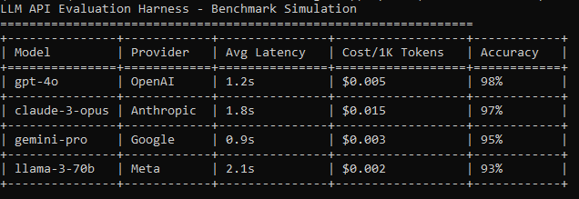

# LLM API Evaluation Harness

Lightweight CLI tool to benchmark multiple LLM providers (OpenAI, Anthropic, Google) via direct API calls. Compares response quality, latency, and cost per token for identical prompts.

## Why This Exists

Commercial chat UIs hide critical metrics (latency, exact token usage, pricing tiers). This harness exposes raw API behavior for informed model selection in production workflows.

## Architecture

```text
Prompt Input -> Parallel API Calls -> Metrics Collection -> CSV/Markdown Report
     |              |                    |                      |
User-defined    GPT/Claude/Gemini    Latency, Cost, Tokens    Structured output

### Example Output
Here is a sample of the benchmark report generated by the harness:


